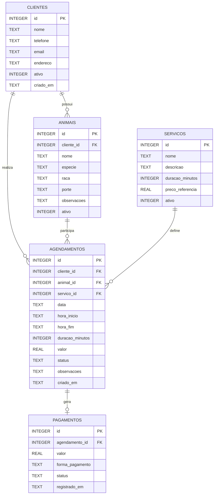

# Modelo ER e estrutura do banco de dados

O banco de dados local do PetAgenda será implementado em SQLite. A modelagem abaixo contempla os cadastros necessários à agenda e o registro financeiro dos atendimentos.

## Diagrama entidade-relacionamento

## Tabelas e colunas

### `clientes`

| Coluna | Tipo SQLite | Restrições |
|---|---|---|
| `id` | INTEGER | Chave primária, autoincremento |
| `nome` | TEXT | NOT NULL |
| `telefone` | TEXT | NOT NULL |
| `email` | TEXT | Opcional |
| `endereco` | TEXT | Opcional |
| `ativo` | INTEGER | NOT NULL, padrão 1, valores 0 ou 1 |
| `criado_em` | TEXT | NOT NULL, data/hora em ISO 8601 |

### `animais`

| Coluna | Tipo SQLite | Restrições |
|---|---|---|
| `id` | INTEGER | Chave primária, autoincremento |
| `cliente_id` | INTEGER | NOT NULL, FK para `clientes(id)` |
| `nome` | TEXT | NOT NULL |
| `especie` | TEXT | NOT NULL |
| `raca` | TEXT | Opcional |
| `porte` | TEXT | Opcional |
| `observacoes` | TEXT | Opcional |
| `ativo` | INTEGER | NOT NULL, padrão 1, valores 0 ou 1 |

### `servicos`

| Coluna | Tipo SQLite | Restrições |
|---|---|---|
| `id` | INTEGER | Chave primária, autoincremento |
| `nome` | TEXT | NOT NULL |
| `descricao` | TEXT | Opcional |
| `duracao_minutos` | INTEGER | NOT NULL, maior que zero |
| `preco_referencia` | REAL | NOT NULL, maior ou igual a zero |
| `ativo` | INTEGER | NOT NULL, padrão 1, valores 0 ou 1 |

### `agendamentos`

| Coluna | Tipo SQLite | Restrições |
|---|---|---|
| `id` | INTEGER | Chave primária, autoincremento |
| `cliente_id` | INTEGER | NOT NULL, FK para `clientes(id)` |
| `animal_id` | INTEGER | NOT NULL, FK para `animais(id)` |
| `servico_id` | INTEGER | NOT NULL, FK para `servicos(id)` |
| `data` | TEXT | NOT NULL, formato `YYYY-MM-DD` |
| `hora_inicio` | TEXT | NOT NULL, formato `HH:MM` |
| `hora_fim` | TEXT | NOT NULL, formato `HH:MM` |
| `duracao_minutos` | INTEGER | NOT NULL, maior que zero |
| `valor` | REAL | NOT NULL, maior ou igual a zero |
| `status` | TEXT | NOT NULL, um de `AGENDADO`, `CONCLUIDO`, `CANCELADO` |
| `observacoes` | TEXT | Opcional |
| `criado_em` | TEXT | NOT NULL, data/hora em ISO 8601 |

### `pagamentos`

| Coluna | Tipo SQLite | Restrições |
|---|---|---|
| `id` | INTEGER | Chave primária, autoincremento |
| `agendamento_id` | INTEGER | NOT NULL, FK para `agendamentos(id)`, UNIQUE |
| `valor` | REAL | NOT NULL, maior ou igual a zero |
| `forma_pagamento` | TEXT | Opcional; por exemplo, dinheiro, cartão ou PIX |
| `status` | TEXT | NOT NULL, por exemplo `REGISTRADO` ou `ESTORNADO` |
| `registrado_em` | TEXT | NOT NULL, data/hora em ISO 8601 |

## Relacionamentos

- **Clientes 1:N Animais:** um cliente pode ter vários animais; cada animal pertence a um cliente.
- **Clientes 1:N Agendamentos:** um cliente pode realizar vários agendamentos.
- **Animais 1:N Agendamentos:** um animal pode participar de vários atendimentos ao longo do tempo.
- **Serviços 1:N Agendamentos:** um serviço pode ser selecionado em vários agendamentos.
- **Agendamentos 1:0..1 Pagamentos:** um agendamento pode não possuir pagamento enquanto estiver pendente; após a conclusão, deverá possuir um registro financeiro. A restrição `UNIQUE` impede mais de um registro de pagamento por agendamento nesta versão.

## Restrições e integridade

- Habilitar `PRAGMA foreign_keys = ON` em cada conexão utilizada.
- Utilizar `NOT NULL` para os campos obrigatórios.
- Utilizar `CHECK` para validar valores booleanos, duração, valores monetários e situação.
- Utilizar `UNIQUE` em `pagamentos.agendamento_id`.
- Utilizar chaves estrangeiras para impedir referências a cadastros inexistentes.
- Utilizar inativação (`ativo = 0`) para clientes, animais e serviços que não devam aparecer em novos registros, preservando o histórico.
- Criar índices para consultas frequentes por data, situação e chaves estrangeiras.

## Observações de modelagem

Os campos `hora_inicio` e `hora_fim` são armazenados no formato `HH:MM`, e a data em `YYYY-MM-DD`. A aplicação deverá calcular e validar o intervalo completo, inclusive quando houver mudança de dia, caso essa possibilidade seja permitida.

O valor e a duração são copiados para o agendamento no momento da criação. Assim, alterações futuras no preço ou na duração padrão do serviço não modificam atendimentos já registrados.

A modelagem considera um estabelecimento por instalação do aplicativo. Caso o projeto passe a suportar vários estabelecimentos, será necessário incluir uma entidade própria e relacioná-la aos registros pertinentes.
