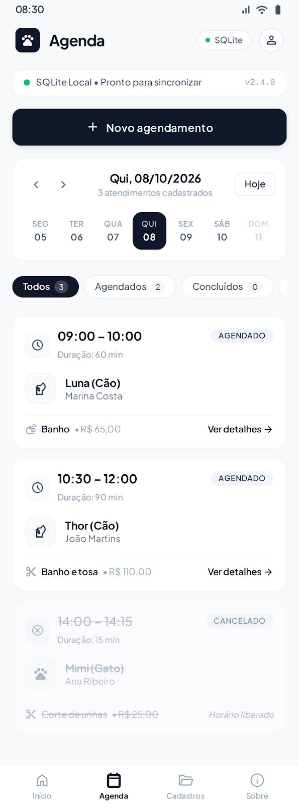
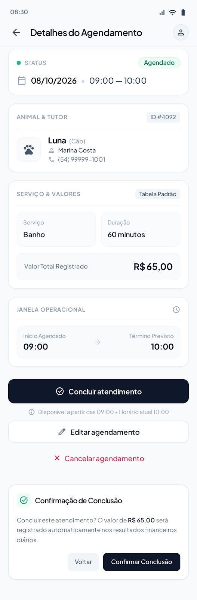
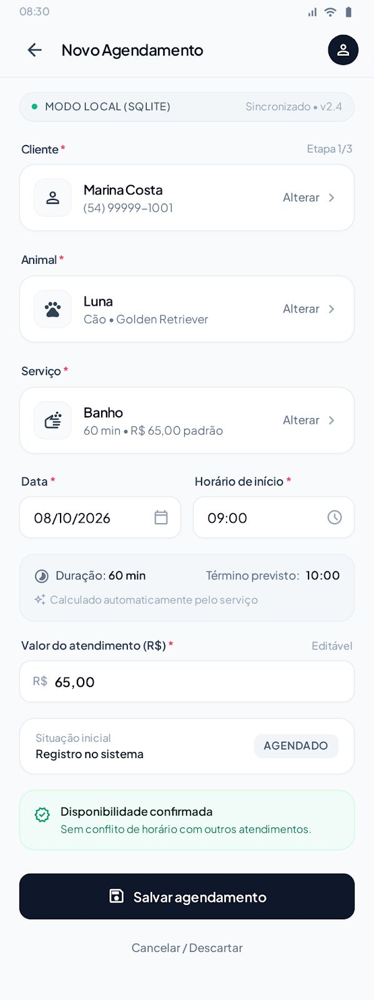
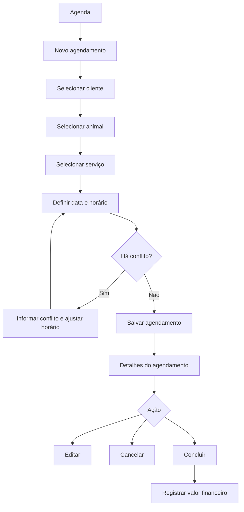

# Wireframes e navegação

Os wireframes de referência foram definidos para uma interface mobile, com cartões de informação, navegação inferior e destaque para ações principais. As imagens de referência devem ser mantidas no diretório `assets/` do repositório.

## 1. Agenda

**Objetivo:** apresentar os atendimentos de uma data selecionada.

**Elementos principais:**
- Cabeçalho com identificação do aplicativo e acesso ao perfil.
- Indicador de armazenamento local SQLite.
- Ação para criar novo agendamento.
- Seletor de data.
- Filtros por situação.
- Cartões com horário, duração, animal, tutor, serviço, valor e situação.
- Navegação inferior para Início, Agenda, Cadastros e Sobre.

## 2. Detalhes do agendamento

**Objetivo:** permitir a consulta e gestão de um atendimento existente.

**Elementos principais:**
- Situação, data e horário.
- Identificação do animal e tutor.
- Serviço, duração e valor registrado.
- Janela operacional do atendimento.
- Ações para concluir, editar ou cancelar.
- Confirmação antes da conclusão do atendimento.

Ao confirmar a conclusão, o sistema deverá atualizar a situação do agendamento e registrar o valor correspondente no controle financeiro, evitando duplicidade.

## 3. Novo agendamento

**Objetivo:** cadastrar um atendimento de forma orientada.

**Elementos principais:**
- Seleção de cliente.
- Seleção de animal vinculado ao cliente.
- Seleção do serviço.
- Data e horário inicial.
- Duração e horário final calculados a partir do serviço.
- Valor sugerido, com possibilidade de edição.
- Aviso de disponibilidade ou conflito de horário.
- Ação para salvar o agendamento.

## Telas complementares previstas

As imagens de referência recebidas não apresentam o desenho detalhado das telas abaixo. Elas deverão seguir a mesma identidade visual e ser definidas durante a implementação:

- **Início:** resumo do dia e indicadores, como quantidade de atendimentos e valores registrados no período.
- **Cadastros:** acesso às listas e formulários de clientes, animais e serviços.
- **Sobre:** identificação do aplicativo, versão e nomes completos dos integrantes do grupo.

## Fluxo principal

